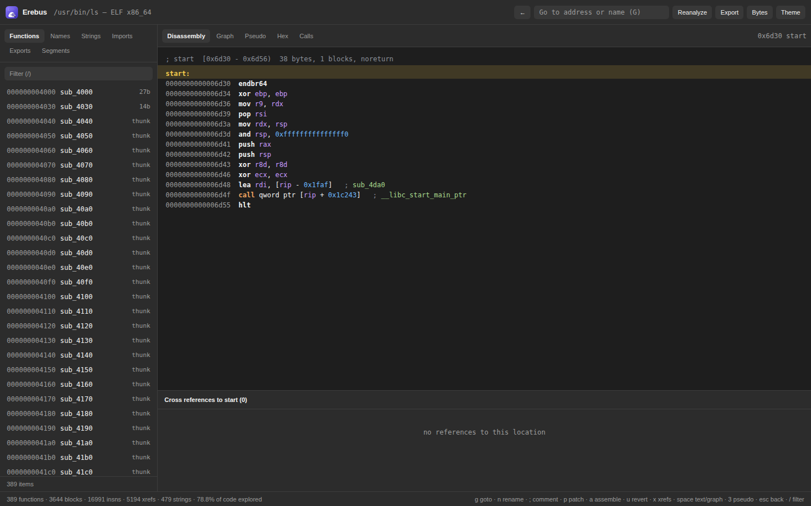
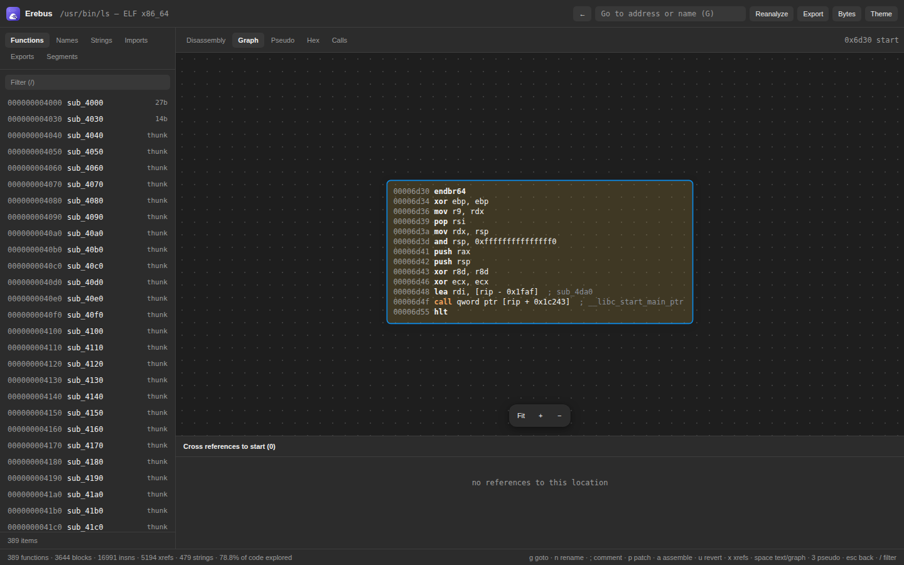
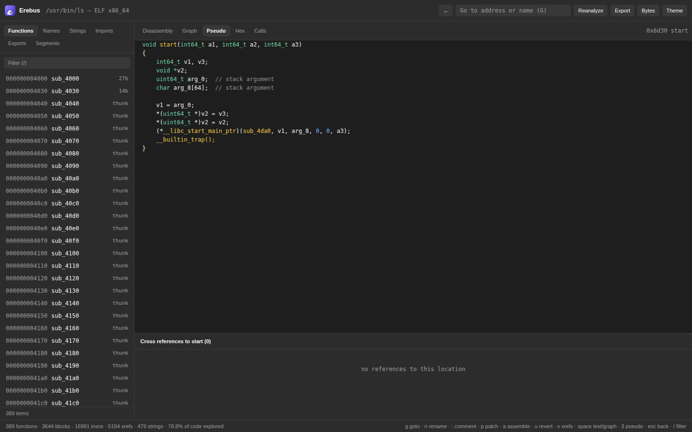

<div align="center">


# Erebus

**An open-source disassembler, analysis database and decompiler — written from scratch, with a native macOS app.**

[](https://github.com/blazfxx/erebus/actions/workflows/ci.yml)
[](LICENSE)
-lightgrey)




</div>

Open a Mach-O, ELF or PE binary and get functions, control-flow graphs, cross-references, strings and
decompiled pseudo-C in a fast, keyboard-driven interface. Everything — loaders, analysis engine, decompiler,
database, UI — is original code on top of [Capstone](https://www.capstone-engine.org) and SQLite.

## Features

| | |
|---|---|
| **Formats** | Mach-O (thin/fat, arm64 · arm64e · x86-64, chained fixups), ELF 32/64, PE32/PE32+ |
| **Architectures** | arm64, x86-64, x86-32 |
| **Analysis** | recursive-descent disassembly, prologue/gap scan, jump-table resolution, noreturn inference, functions · basic blocks · CFG, code/data xrefs, strings (ASCII/UTF-8/UTF-16), pointer tables |
| **Decompiler** | structured pseudo-C (`if` / `while` / `do-while` / `switch`), call-argument recovery, SysV · Win64 · Apple ABIs, variable naming, stack-protector stripping |
| **Metadata** | Objective-C classes & categories (`-[Class sel]`, `[obj sel:arg]` rendering), Swift symbol demangling, C++ demangling |
| **Patching** | assemble in place, patch bytes, revert, re-analyse, export a patched (re-signed) binary |
| **Database** | one portable SQLite file (`.erdb`) with bytes, analysis, names, comments and patches |
| **Interfaces** | native macOS app · web UI · CLI/REPL · Python client |

<table>
<tr>
<td width="50%"><br><sub><b>CFG graph</b> — layered layout, true/false edges, pan &amp; zoom</sub></td>
<td width="50%"><br><sub><b>Pseudo-code</b> — clickable names, structured control flow</sub></td>
</tr>
</table>

## Install

### The app (macOS 13+, Apple silicon)

1. Download `Erebus-<version>-macos-arm64.dmg` from the [Releases](https://github.com/blazfxx/erebus/releases) page and drag **Erebus** to *Applications*.
2. The app is ad-hoc signed, not notarized. On first launch use **right-click → Open**, or run
   `xattr -dr com.apple.quarantine /Applications/Erebus.app`.
3. Open a binary with **File → Open…**, by dropping it on the window or the Dock icon, or from Finder with *Open With → Erebus*.
   Analysis results are cached in `~/Library/Application Support/Erebus/Databases`.

Or build it yourself — see below.

### Build from source

```sh
brew install cmake ninja capstone cpp-httplib nlohmann-json
git clone https://github.com/blazfxx/erebus && cd erebus

cmake -S . -B build -G Ninja && cmake --build build     # CLI / engine  -> build/erebus
scripts/build-app.sh --zip --dmg                        # app bundle    -> dist/Erebus.app (+ .zip / .dmg)
```

The assembler behind `asm` is optional: install [Keystone](https://www.keystone-engine.org) (`brew install keystone`) and Erebus
loads it at runtime. It is deliberately **not linked** (Keystone is GPL-2.0; Erebus stays MIT). Raw `patch` works without it.

## Using it

### App / web UI

| Key | Action | | Key | Action |
|---|---|---|---|---|
| `g` | go to address or name | | `p` | patch bytes |
| `n` | rename (hover a name) | | `a` | assemble instruction |
| `;` | comment | | `u` | revert patch |
| `x` | cross-references | | `b` | show opcode bytes |
| `space` | toggle listing ⇄ graph | | `3` | pseudo-code |
| `esc` | go back | | `/` | filter lists |

The Erebus app uses the same UI; ⌘O opens a file, ⇧⌘R re-analyses, ⌘+/⌘− zoom.

### Command line

```sh
erebus open  /bin/ls --arch arm64e          # analyse into ls.erdb
erebus serve ls.erdb                        # web UI in your browser
erebus shell ls.erdb                        # interactive prompt
erebus ls.erdb pseudo start                 # one-shot: decompile a function
erebus ls.erdb xrefs _getenv                # who calls getenv?
erebus ls.erdb asm 0x100001234 "nop"        # assemble over an instruction
erebus ls.erdb export ls.patched --sign     # write the patched binary
```

Run `erebus <db> help` for all commands: `info segs funcs names imports exports strings disasm xrefs callers callees
callgraph cfg hex find gaps pseudo rename comment patch asm unpatch patches export reanalyze`.

### Python

```python
from erebus import Erebus            # tools/erebus.py, standard library only

with Erebus.open("/usr/bin/curl", arch="arm64") as e:
    for f in e.funcs("usage"):
        print(f.addr, f.name)
    print(e.pseudo("start")[:400])
    e.rename("0x100002ac4", "parse_options")
```

See [`tools/examples`](tools/examples) for a complete plugin-style script.

## How it works

```
 binary ──► loaders ──► Image ──► analysis engine ──► .erdb (SQLite)
 (Mach-O/ELF/PE)      (segments,   (Capstone decode,       │
                       symbols)     CFG, xrefs, tables)     ├─► decompiler (lift → dataflow → structure → C)
                                                            ├─► CLI / REPL
                                                            ├─► HTTP API ─► web UI · macOS app · Python
                                                            └─► patch / assemble / export
```

A deeper tour lives in [docs/ARCHITECTURE.md](docs/ARCHITECTURE.md).

## Quality

- `./tests/run.sh` — cross-checks the disassembly against `otool` (e.g. `/usr/bin/file` matches all 21,928 instructions), exercises
  the ELF/PE loaders, runs the decompiler over every function of real binaries, and tests patching and the Python client.
- `python3 tests/fuzz.py 300 1` — mutation fuzzing of every loader, the analyzer and the decompiler (no crashes or hangs allowed).
- CI builds the engine and the app on every push.

## Limitations

Erebus is young. Known gaps: no struct/type recovery (variables are `a1`/`v1`, typed only as int/pointer), stdcall stack cleanup is not
modelled for x86-32, no Swift metadata parsing (names only), no debugger, ARM32/MIPS/etc. are not supported, and the app is Apple-silicon only
(Intel Macs can build from source). Decompiler output is a *reading aid* — verify against the disassembly.

## Contributing

Issues and pull requests are welcome — see [CONTRIBUTING.md](CONTRIBUTING.md) and the [Code of Conduct](CODE_OF_CONDUCT.md).
Security reports: [SECURITY.md](SECURITY.md).

## License & credits

[MIT](LICENSE) © 2026 blazfoxx. Third-party components and their licenses are listed in
[THIRD_PARTY_NOTICES.md](THIRD_PARTY_NOTICES.md): Capstone (BSD-3), cpp-httplib (MIT), nlohmann/json (MIT), SQLite (public domain);
Keystone (GPL-2.0) is only loaded at runtime if you install it.

Erebus is an independent project, not affiliated with or endorsed by Hex-Rays (IDA), the NSA (Ghidra), or Apple.
Use it only on software you own or are authorized to analyse.
